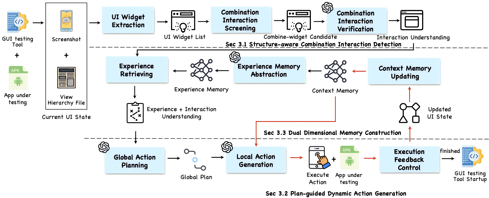
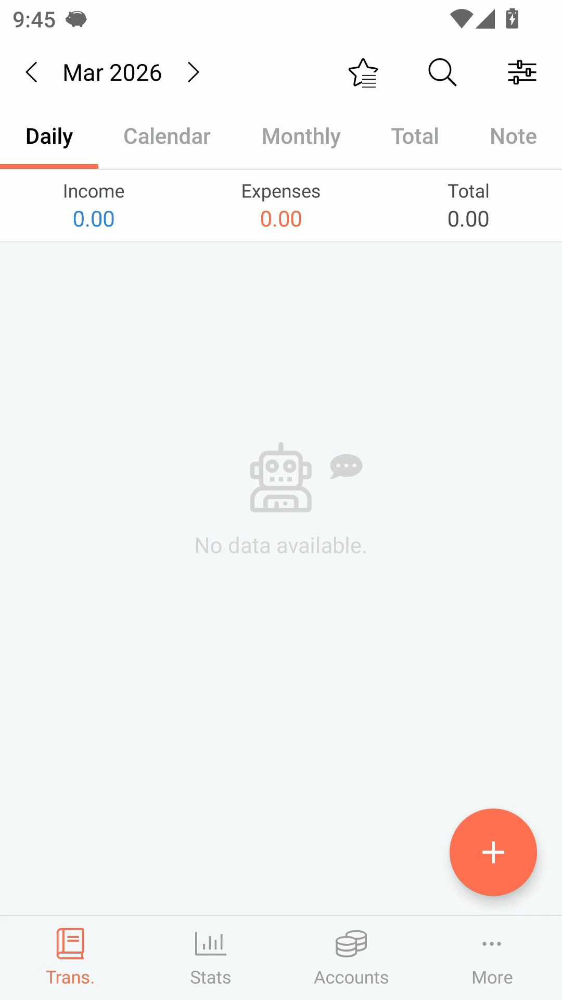
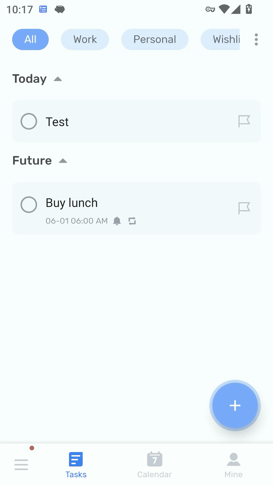
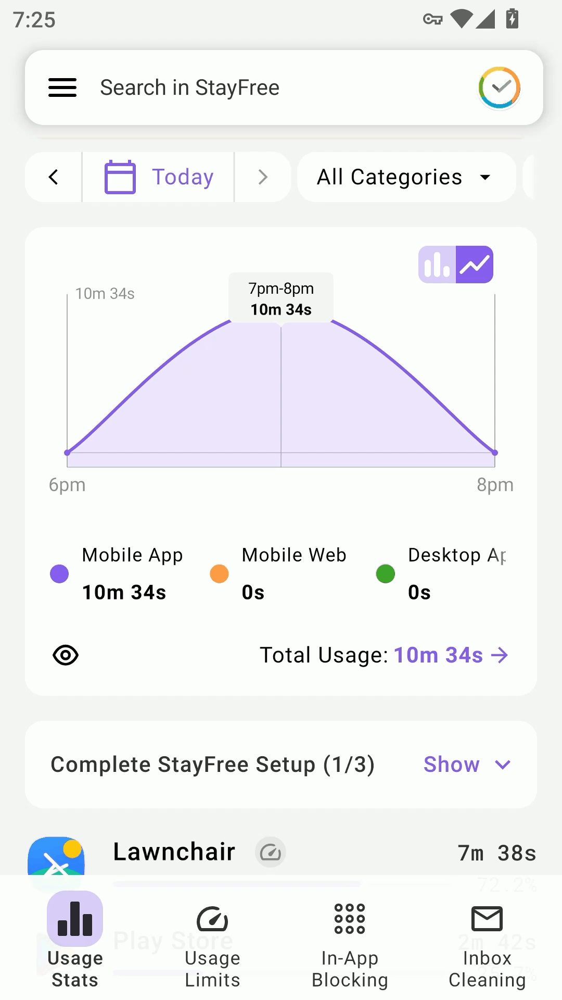
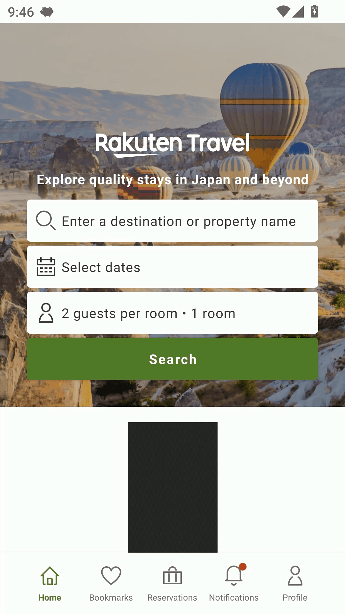

# COMBDroid

[](https://doi.org/10.6084/m9.figshare.31932618)

## Overview

COMBDroid is an automated GUI testing framework for handling **combination interactions** in Android apps. It targets page-level, function-oriented interaction workflows that require coordinated operations across multiple dependent widgets within the same functional context, rather than isolated single-widget actions. The approach is built around **structured planning** and **dual memory**, enabling reliable execution of multi-step GUI tasks such as logging, search, booking, editing, and configuration flows.



## Key Features

- **Combination-Interaction-Aware Testing**: Detects pages that require coordinated operations across multiple widgets before a functionality can proceed
- **Structure-Aware Detection**: Screens candidate pages from GUI structure and verifies them with multimodal semantic analysis
- **Plan-Guided Execution**: Generates page-level interaction plans and grounds them into widget-level executable actions
- **Dual Memory Mechanism**: Maintains both context memory for ongoing execution state and experience memory for reusable interaction patterns
- **Execution Feedback Control**: Monitors post-action GUI changes and dynamically corrects deviations during multi-step execution
- **Strong Empirical Performance**: Achieves a 0.77 passing rate on 100 combination interaction functionalities, improves activity coverage by 65%–100% when integrated with existing tools, and enables detection of previously unseen crash bugs

## Examples

These are examples from testing Android applications with COMBDroid.

<div align="center">
  
  
  
  <br>
  
  
  
</div>

## Code

See details in `code/`.

Follow the steps below to set up, configure, and run the available components.

### Features

- Extracts structured GUI components from Android UI hierarchy
- Captures screenshots for page understanding
- Builds LLM prompts from GUI state and execution memory
- Executes structured GUI actions:
  - `click`
  - `input`
  - `scroll`
  - `wait`
  - `stop`
- Tracks execution feedback and GUI state changes
- Stores step-level artifacts for traceability and debugging
- Maintains context memory across multi-step interactions


### Project Structure

```text
GUI_AGENT/
├── action/
│   ├── executor.py
│   └── local_action.py
├── memory/
│   └── context_memory.py
├── perception/
│   └── extract_components.py
├── planning/
│   ├── experience_summarizer.py
│   └── global_plan.py
├── runs/
├── controller.py
├── experiment_logger.py
├── main.py
└── readme.md
```

#### Module Overview

* `main.py`
  Entry point for launching the GUI agent.

* `controller.py`
  Controls the full interaction loop, including step execution, termination checks, and logging.

* `experiment_logger.py`
  Manages run directories and step-level output files.

* `perception/extract_components.py`
  Connects to the Android device, captures screenshots, dumps UI hierarchy, and extracts structured GUI components.

* `planning/global_plan.py`
  Builds prompt packages for the planner using the current UI state and memory.

* `planning/experience_summarizer.py`
  Summarizes successful interaction traces into reusable high-level experience memory.

* `action/local_action.py`
  Parses and validates structured LLM responses into executable local actions.

* `action/executor.py`
  Executes actions on the Android device and checks post-action UI changes.

* `memory/context_memory.py`
  Stores recent execution history and interaction context across steps.


### Workflow

COMBDroid operates in the following stages:

1. **Perception**

   * Capture the current screenshot
   * Dump the current UI hierarchy
   * Extract GUI components and build a UI state representation

2. **Planning**

   * Construct a prompt package using:

     * current screenshot path
     * component list
     * memory summary
   * Obtain the next action from the LLM

3. **Action Parsing**

   * Convert the LLM response into a validated local action

4. **Execution**

   * Execute the action on the device
   * Re-dump the UI state after execution

5. **Feedback and Memory Update**

   * Check whether the UI changed
   * Record action history and feedback
   * Continue until a termination condition is met


### Environment Setup

#### 1. Python

Create and activate a Python environment:

```bash
conda create -n combdroid python=3.10 -y
conda activate combdroid
```

Install dependencies:

```bash
pip install -r requirements.txt
```

#### 2. Android Testing Environment

COMBDroid requires an Android device environment accessible through **ADB** and compatible with **uiautomator2**.

Before running the framework, ensure that:

* the Android device is visible through `adb devices`
* UI automation is available
* screenshots and UI hierarchy dumping work correctly


### Requirements

Dependencies are listed separately in `requirements.txt`.


### Running COMBDroid

Basic usage:

```bash
python main.py --device <device_serial> --run-name <run_name>
```

Example:

```bash
python main.py --device <device_serial> --run-name demo_run --max-steps 10
```

#### Main Arguments

* `--device`
  Android device serial visible to ADB

* `--run-name`
  Name of the current run

* `--max-steps`
  Maximum number of interaction steps

* `--output-dir`
  Output directory for run artifacts

* `--include-system-ui`
  Include system UI components during perception

* `--repeat-threshold`
  Threshold for repeated ineffective execution

* `--no-wait`
  Do not wait for LLM response files


### Manual LLM-Driven Loop

The current implementation supports a manual planning workflow.

At each step, COMBDroid exports:

* prompt package JSON
* system prompt
* user prompt

The expected LLM response is a JSON object containing the next action.

Example action schema:

```json
{
  "page_understanding": "This page is a booking date selection screen.",
  "next_action": {
    "action_type": "click",
    "target_id": "node_42",
    "input_text": "",
    "reason": "Select the check-in date."
  },
  "is_complete": false
}
```

Supported action types:

* `click`
* `input`
* `scroll`
* `wait`
* `stop`


### Output Artifacts

Each run produces a structured directory under `runs/`.

Example layout:

```text
runs/
└── <run_name>/
    ├── step_000/
    │   ├── screen.png
    │   ├── hierarchy.xml
    │   ├── ui_state.json
    │   ├── actionable_components.json
    │   ├── prompt_package.json
    │   ├── system_prompt.txt
    │   ├── user_prompt.txt
    │   ├── llm_response.json
    │   ├── step_result.json
    │   └── memory_snapshot.json
    ├── step_001/
    └── ...
```

These artifacts support:

* execution replay
* debugging
* trace analysis
* memory inspection


### Current Capabilities

The current codebase supports:

* Android GUI state extraction
* structured component representation
* step-wise LLM planning
* validated local action parsing
* robust input execution with fallbacks
* repeated-state detection
* run logging and memory snapshots


### Notes

* Some repository files may be temporary or experiment-specific and are not part of the core runtime pipeline.
* The framework is currently oriented toward Android GUI automation and structured multi-step interaction execution.
* The current implementation is suitable for experimentation, debugging, and extension of LLM-based GUI testing workflows.


## Pilot Study Dataset

See details in `pilot_study_dataset/`.

This dataset supports the motivational study of COMBDroid. The pilot study sampled 450 popular Google Play apps across 15 categories and identified 351 apps that contain at least one page requiring combination interactions.

### Category Distribution

| Category | Ratio |
|----------|-------|
| Logging | 32% |
| Search | 28% |
| Booking | 21% |
| Editing | 11% |
| Configuration | 8% |

## Experiment Dataset

See details in `experiment_dataset/`.

### RQ1 & RQ2

The RQ1 and RQ2 dataset is built from 100 combination interaction functionalities collected from 100 apps. The paper states that the sampled functionalities preserve the category ratio **32:28:21:11:8**, and the average number of actions per function is **6**.

#### Table 1. Performance of COMBDroid and Baselines (RQ1)

| Baselines | Logging | Search | Booking | Editing | Config | All |
|-----------|---------|--------|---------|---------|--------|-----|
| **Random-based method** |||||||
| Monkey | 0.06 | 0.04 | 0.05 | 0.09 | 0.13 | 0.06 |
| Droidbot | 0.06 | 0.04 | 0.05 | 0.09 | 0.13 | 0.06 |
| TimeMachine | 0.09 | 0.07 | 0.05 | 0.09 | 0.13 | 0.08 |
| **Model-based method** |||||||
| WCTester | 0.09 | 0.07 | 0.05 | 0.18 | 0.13 | 0.09 |
| Fastbot | 0.09 | 0.07 | 0.10 | 0.18 | 0.13 | 0.10 |
| ComboDroid | 0.13 | 0.07 | 0.10 | 0.09 | 0.13 | 0.10 |
| **Combinational method** |||||||
| Stoat+TO | 0.09 | 0.07 | 0.10 | 0.18 | 0.13 | 0.10 |
| Ape+VE | 0.13 | 0.04 | 0.05 | 0.18 | 0.13 | 0.09 |
| **Learning-based method** |||||||
| Humanoid | 0.13 | 0.07 | 0.10 | 0.09 | 0.13 | 0.10 |
| Q-testing | 0.09 | 0.07 | 0.10 | 0.09 | 0.13 | 0.09 |
| **LLM-based method** |||||||
| GPTDroid | 0.28 | 0.21 | 0.24 | 0.27 | 0.38 | 0.26 |
| DroidAgent | 0.28 | 0.25 | 0.29 | 0.36 | 0.38 | 0.29 |
| AUITestAgent | 0.31 | 0.32 | 0.33 | 0.36 | 0.50 | 0.34 |
| VisionDroid | 0.34 | 0.39 | 0.38 | 0.36 | 0.50 | 0.38 |
| QTypist | 0.25 | 0.21 | 0.19 | 0.27 | 0.13 | 0.22 |
| **COMBDroid** | **0.78** | **0.75** | **0.81** | **0.73** | **0.75** | **0.77** |

#### Coverage Summary (RQ2)

When integrated with existing tools, COMBDroid improves activity coverage from **0.12–0.32** to **0.22–0.56**. The greatest improvement is observed on **DroidAgent**, where coverage increases from **0.25** to **0.50** (**100%** improvement). The lowest reported improvement is on **Q-testing**, where coverage increases from **0.20** to **0.33** (**65%** improvement).

### RQ3

The RQ3 evaluation is conducted on 150 apps. The paper reports that COMBDroid detects **53 crash bugs in 49 apps**, including **37 previously unseen bugs in 35 apps**. Among these 37 new bugs, **26 were fixed** and **11 were confirmed** by developers.

#### Table 2. Information of the Fixed Bugs (RQ3)

| ID | App Name | Category | Down | Version | GD w/o | DA w/o | VD w/o | GD w | DA w | VD w |
|----|----------|----------|------|---------|--------|--------|--------|------|------|------|
| 1 | Pedometer | Health | 50M+ | 5.56 |  |  |  | ✓ | ✓ |  |
| 2 | Flo Period | Health | 50M+ | 4.5.1 |  |  |  | ✓ | ✓ |  |
| 3 | Wattpad | Book | 50M+ | 11.2.0 |  |  |  | ✓ | ✓ | ✓ |
| 4 | Yelp | Food | 50M+ | 25.11 |  |  |  | ✓ | ✓ |  |
| 5 | ReadEra | Book | 50M+ | 26.02 |  |  | ✓ | ✓ | ✓ | ✓ |
| 6 | Rain Radar | Weather | 50M+ | 26.3 |  |  |  | ✓ | ✓ |  |
| 7 | Expedia | Travel | 50M+ | 2026.3 |  |  |  | ✓ | ✓ | ✓ |
| 8 | Hote Deals | Travel | 10M+ | 26.1.0 |  |  |  |  |  | ✓ |
| 9 | komoot | Health | 10M+ | 6.3.3 |  |  | ✓ | ✓ | ✓ | ✓ |
| 10 | EasyNotes | Product | 10M+ | 1.2.98 |  |  | ✓ | ✓ | ✓ | ✓ |
| 11 | Webex | Business | 10M+ | 45.2.0 |  |  |  | ✓ | ✓ |  |
| 12 | KiKUU | Shop | 10M+ | 30.1.6 |  |  |  |  |  | ✓ |
| 13 | NYTimes | News | 10M+ | 11.67.0 |  |  | ✓ | ✓ | ✓ | ✓ |
| 14 | HelloTalk | Education | 10M+ | 6.0.6 |  |  |  |  |  | ✓ |
| 15 | Cheapflights | Travel | 10M+ | 224.1 |  |  |  | ✓ | ✓ |  |
| 16 | WSJ | News | 5M+ | 6.36 | ✓ | ✓ | ✓ | ✓ | ✓ | ✓ |
| 17 | Cash Book | Business | 5M+ | 167 |  |  |  | ✓ | ✓ |  |
| 18 | Calendar | Product | 5M+ | 2.2.1 |  |  |  | ✓ | ✓ | ✓ |
| 19 | Retro Music | Music | 5M+ | 6.5.0 |  |  |  |  |  | ✓ |
| 20 | BeFriend | Social | 1M+ | 11.0.5 |  |  |  | ✓ | ✓ | ✓ |
| 21 | Runna | Health | 1M+ | 8.30.0 |  |  |  | ✓ | ✓ |  |
| 22 | Spendee | Finance | 1M+ | 5.5.50 |  |  |  | ✓ | ✓ | ✓ |
| 23 | Cashew | Finance | 500K+ | 5.4.4 |  |  |  | ✓ | ✓ |  |
| 24 | GAFFL | Travel | 100K+ | 2.24 |  |  |  | ✓ | ✓ |  |
| 25 | HopeGoo | Travel | 100K+ | 1.38.0 |  |  |  | ✓ | ✓ |  |
| 26 | SpendTracker | Finance | 100K+ | 6.0.1 |  |  |  | ✓ | ✓ |  |

## Results Highlights

### Table 3. Performance of Different GUI Agent Methods

| Method | Logging | Search | Booking | Editing | Config | All |
|--------|---------|--------|---------|---------|--------|-----|
| AppA | 0.22 | 0.32 | 0.19 | 0.18 | 0.25 | 0.24 |
| MA | 0.28 | 0.36 | 0.33 | 0.27 | 0.38 | 0.32 |
| AutoD | 0.31 | 0.29 | 0.24 | 0.27 | 0.25 | 0.28 |
| DGPT | 0.31 | 0.36 | 0.29 | 0.36 | 0.38 | 0.33 |
| MobA | 0.25 | 0.32 | 0.29 | 0.27 | 0.38 | 0.29 |
| ME | 0.25 | 0.25 | 0.19 | 0.27 | 0.13 | 0.23 |
| **COMBDroid** | **0.78** | **0.75** | **0.81** | **0.73** | **0.75** | **0.77** |

### Table 4. Contribution of Different Sub-modules

| Module | Log | Search | Book | Edit | Config | All |
|--------|-----|--------|------|------|--------|-----|
| **COMBDroid** | **0.78** | **0.75** | **0.81** | **0.73** | **0.75** | **0.77** |
| w/o Verification | 0.63 | 0.57 | 0.52 | 0.45 | 0.50 | 0.56 |
| w/o Retrieval | 0.34 | 0.36 | 0.38 | 0.45 | 0.38 | 0.37 |
| w/o Experience | 0.44 | 0.43 | 0.48 | 0.45 | 0.50 | 0.45 |
| w/o Context | 0.28 | 0.32 | 0.38 | 0.36 | 0.38 | 0.33 |
| w/o Page-level | 0.31 | 0.32 | 0.38 | 0.36 | 0.38 | 0.34 |
| w/o Widget-level | 0.28 | 0.36 | 0.38 | 0.36 | 0.38 | 0.34 |
| w/o Feedback | 0.59 | 0.61 | 0.62 | 0.45 | 0.50 | 0.58 |
| Gemini-1.5-Pro | 0.72 | 0.71 | 0.76 | 0.64 | 0.63 | 0.71 |
| LLaMA-4 | 0.69 | 0.64 | 0.76 | 0.64 | 0.63 | 0.68 |

## Citation

If you use COMBDroid in research, please cite the corresponding paper and repository.
